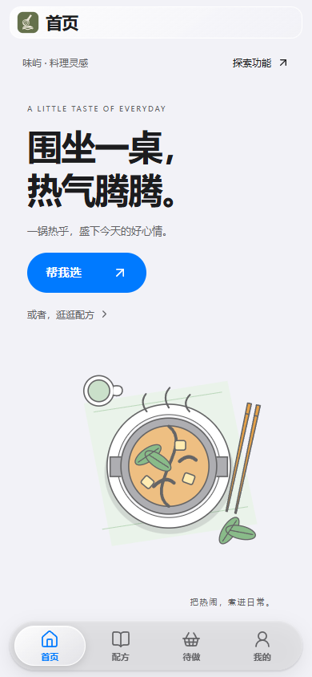
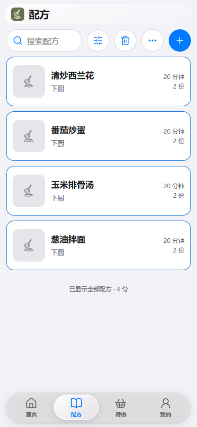
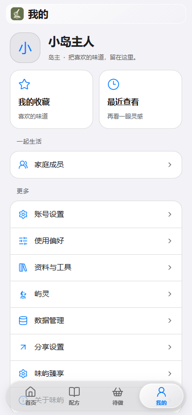

<h1 align="center">味屿 · SavorIsle</h1>

把喜欢的味道，留在家里。

家庭配方 · 份量换算 · 制作计划 · 家人点菜

味屿是一座属于你家的下厨小岛。把常做的菜、烘焙配方和厨房资料收在一起，从今天吃什么，到准备材料、安排制作，再到按步骤下厨，都可以在手机上完成。

## 从一份配方开始

- **留住好味道**：按分组记录材料、厨具和制作步骤，添加图片、标签与说明，收藏喜欢的配方。
- **换算今天的用量**：调整人数或倍率，查看材料合计、步骤用量和营养参考。
- **安排下厨**：把想做的配方加入待做，整理制作计划、备料与采购清单，边做边查看步骤和计时。
- **一起决定吃什么**：从家庭配方中挑选，建立菜单和点菜册，通过菜单码与家人分享。
- **整理厨房资料**：管理食材、品牌、产品和厨具，保存常用选项。
- **让整理更轻松**：导入配方文件或分类菜谱资源包，核对材料与步骤后保存；支持下载加速与批量管理。

## 手机上，随手就能用

<table>
<tr><td align="center"> 今天吃什么</td><td align="center"> 家庭配方库</td><td align="center"> 材料与步骤</td></tr>
<tr><td align="center"> 编辑配方</td><td align="center"> 我的小岛</td><td align="center"> 外观与使用偏好</td></tr>
</table>

## 安装味屿

从[版本发布](https://github.com/DyMode/SavorIsle/releases/latest)下载安装包，在飞牛 fnOS 应用中心手动安装与 NAS 处理器架构匹配的 FPK 安装包，安装向导可设置服务端口（默认 `18780`）。安装后以 NAS 管理员身份从飞牛桌面打开味屿，首次打开时创建家庭管理员，手机也可访问 `http://NAS地址:服务端口/app/savorisle/`。

安装包支持 x86-64 与 ARM64，按 NAS 的处理器架构选择；系统要求见安装包说明。

- [安装说明](docs/INSTALL.md)
- [使用指南](docs/GUIDE.md)
- [外部助手接入](docs/INTEGRATIONS.md)
- [完整文档索引](docs/README.md)

## 发布与接入

[下载安装包](https://github.com/DyMode/SavorIsle/releases/latest) · [厨房资料包](https://github.com/DyMode/SavorIsle-Packs) · [外部助手技能](skills/savorisle-recipe-import/SKILL.md)

提供 x86-64 与 ARM64 安装包及 SHA-256 校验文件，具体发布信息见版本说明。

## 支持与联系

使用问题可通过 GitHub Issues 或 support@dymode.com 反馈。

### ☕ 赞赏支持开发

如果味屿让你的下厨日常更轻松，欢迎请我喝杯咖啡，支持后续的体验打磨、维护与更新。谢谢你陪这座小岛慢慢成长。

| 微信赞赏 | 支付宝 |
| :---: | :---: |
|  |  |

可直接扫码，或保存图片后在对应应用中识别。赞赏为自愿支持开发，详情见[支持说明](support/README.md)。

臻享服务及隐私说明见[协议说明](docs/LEGAL.md)。

## 许可

接入技能和 Python 工具采用 MIT；文档采用 CC BY 4.0。应用程序、品牌图标、界面截图和收款图不在上述开源许可范围内，具体见[许可说明](LICENSE)。
