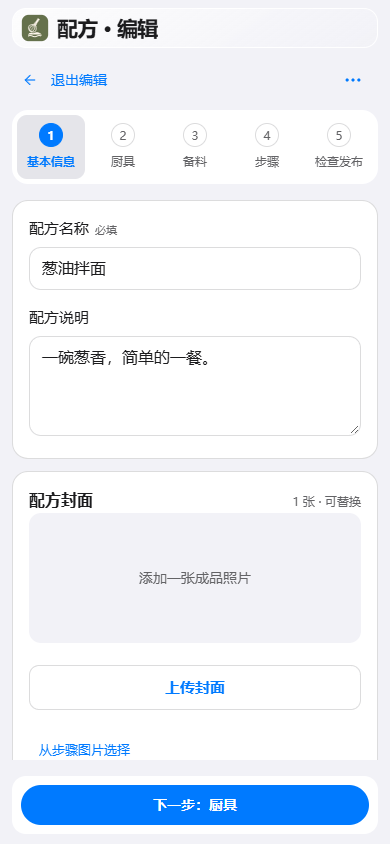
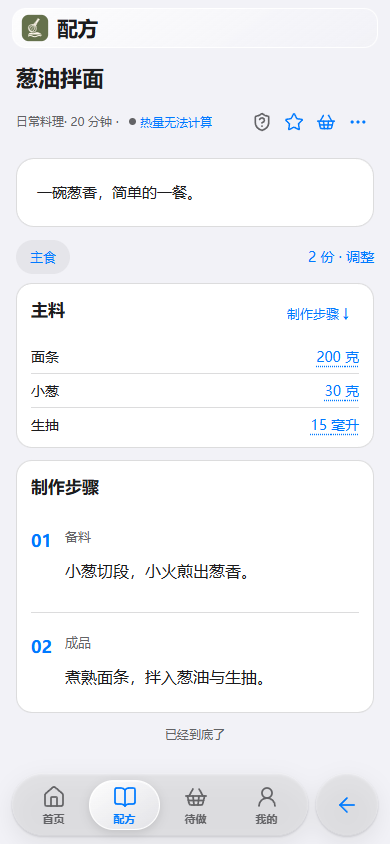
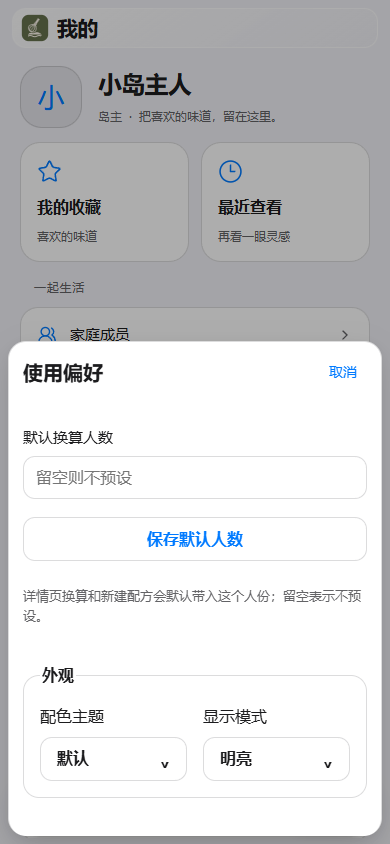

# 味屿使用指南

## 四个入口

**首页**提供吃什么、做什么的选择入口。**配方**收纳家庭配方，支持搜索与筛选。**待做**用于安排制作。**我的**集中展示收藏、最近查看、家庭成员、使用偏好和厨房资料。

首页的「探索」汇集吃什么、做什么、菜单与点菜册等入口。「吃什么」从家庭已发布配方随机搭一餐，可选择几菜几汤、锁定和逐道换菜，并将结果加入待做；「做什么」挑选单份配方。

锁定的菜在整餐重抽时保留，同一餐不重复。可对单道或整餐设置临时排除条件；没有替代结果时保留原菜并提示。长期偏好在设置面板中保存。

## 记录与查看配方

在配方页点击添加按钮，选择手工新增，按基本信息、厨具、备料、步骤与检查发布填写。材料可以分组，填写定量、适量或范围；步骤可关联材料、图片和计时。保存为草稿后可以继续编辑，发布后进入家庭配方库。

打开配方可查看分组材料、制作步骤和说明。调整份量与倍率后，材料用量随之换算。收藏可从「我的收藏」快速找回，最近打开的配方可在「最近查看」重看。

## 从待做到下厨

将配方加入待做，建立制作计划，查看所需材料与采购汇总。跟做时按步骤推进，使用步骤计时，完成后保留制作记录。

## 和家人一起选菜

在「首页 → 探索」打开菜单与点菜册。把配方加入菜单，记录份量与备注；使用点菜册汇集家人的选择，通过菜单码分享餐单。普通岛友可以创建和管理自己的菜单，岛主可以管理所有菜单。

岛主在「我的 → 分享设置」填写对外访问地址后，菜单和点菜册才能生成分享链接。复制链接和菜单二维码使用该地址，应用内预览保留当前访问入口。

## 厨房资料与配方导入

「我的 → 资料与工具」包含基础资料和外部助手接入。基础资料用于管理食材、品牌、产品和厨具，录入配方时可以复用这些选项。具备资料包功能可下载和使用全部资料包；内置资料和自建资料可直接使用。臻享到期后，已有配方中的资料快照仍可查看。

家庭成员可在「我的 → 味屿臻享」查看状态，获取入口仅向岛主展示。首次初始化登记设备并自动领取七日体验；未能开启时可手动重试。正式臻享由管理员按设备码配置一个月、一季度、半年或一年，整套包含资料包与屿灵。

NAS 在运行期间每日联系授权服务，更新体验、正式或未授权状态。网络失败不会提前关闭有效授权，原有效期到期后正常关闭；已有配方和资料快照保留。

未开通时可输入当前同步口令，凭口令获取管理员已配置的授权。五次未成功后冷却一分钟，之后每五次冷却五分钟；取得有效授权后隐藏获取入口。正式臻享首次开启时展示一次升级动画。

文件导入支持 JSON 与 ZIP 配方包，核对材料、步骤和资料匹配后，确认将所选配方新增或更新到配方库。删除完成记录不会删除配方。

文字、图片或文档可交给 [屿灵](YULING.md) 整理，核对后进入编辑并发布；外部助手的使用见 [接入说明](INTEGRATIONS.md)。

## 外观与个人设置

「我的」页面直接提供「联系支持」与「支持开发」。联系支持使用 DyMode 支持邮箱 `support@dymode.com`；「打开邮件应用」打开用户自己的邮件应用并预填反馈模板，不会自动发送或上传日志。未配置邮件应用时，可复制邮箱自行写信。

目前暂未开放臻享付费购买，支持开发属于自愿打赏，不对应臻享权益。支持开发面板展示微信赞赏与支付宝，并可保存收款图。用户协议与隐私说明位于「关于味屿」，臻享页提供「臻享服务说明」，也可阅读[协议内容](LEGAL.md)。

「我的 → 使用偏好」可以设置默认换算人数、配色主题和显示模式。

- **默认**：灰白与黑灰底色，蓝色交互强调色和通透玻璃材质。
- **青屿**：柔和的绿色与暖色背景，延续味屿原有配色。
- **明亮／暗黑／跟随系统**：两套主题都支持；首次使用为明亮。

外观选择记录在用户账号中，同一用户在其他设备登录后自动恢复。点击左上应用图标按明亮、暗黑、跟随系统循环切换。应用图标保留原有橄榄绿与陶橙配色。

## 家庭与数据

家庭管理员在「我的 → 家庭成员」管理成员。在「账号设置」查看账号信息与登录会话。管理员可在「数据管理 → 系统备份」创建、下载和恢复备份，管理自动备份保留与存储。

### 营养匹配

在食材或食品的营养信息编辑页，可使用已配置的屿灵服务匹配营养建议，也可粘贴包装营养表。核对基准用量、单位和来源后点击“采用建议”，保存资料后生效。未知项留空；匹配使用模型服务的每日次数额度。

协议版本按家庭保存在 NAS 中。首次保存当前版本，不再弹窗；后续协议版本变化仅向岛主提示，确认后更新记录。

「关于味屿」提供 GitHub 仓库访问与复制链接、用户协议及隐私说明。关闭协议后返回关于页；复制结果通过短暂提示显示。
